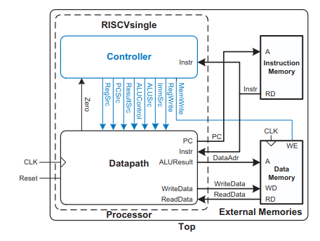

# whats up

## short notice on how to use the make file
```
make sim                   # compile + simulate all, NAME=xxx for specific file  
make view                  # same, then open GTKWave, same NAME option
make view TOP=alu_tb       # simulate a different testbench  
make clean
```

the make file sometimes bugs out so if you want to run command by command use the following

``` 
    ghdl -a --std=08 --workdir=build src/and_gate.vhd tb/and_gate_tb.vhd
    ghdl -e --std=08 --workdir=build and_gate_tb
    ghdl -r --std=08 --workdir=build and_gate_tb --wave=build/out.ghw
    gtkwave build/out.ghw
```

## resources

- [https://github.com/riscv/learn.git](https://github.com/riscv/learn.git)
- Computer Organization and Design RISC-V Edition: The Hardware Software Interface
- <https://www.cse.iitd.ac.in/~srsarangi/archbooksoft.html>
- <https://github.com/riscv/riscv-isa-manual.git>
- <https://github.com/openhwfoundation/cv32e40p.git>

## Documentation

### ALU

the ALU is pretty straight forward nothing complicated, it is just an entity that has input(32-bit) and the ALU_OP (4 bits) which defines which operation is done then in the architecture a simple comparison is done and the output is decided.

### Memory

the memory is divided into registers and data memory (TODO)

### CPU

This part was by far the most challanging but thankfully the books and resources explain it clearly and in simple terms so i was able to make quick work of it  


